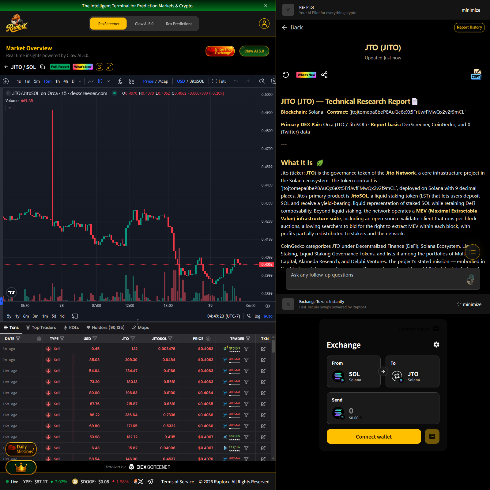
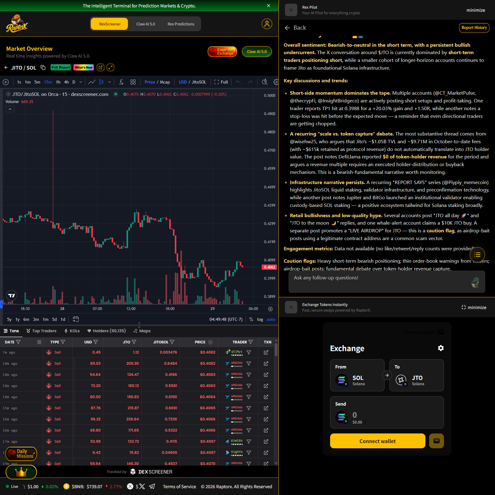
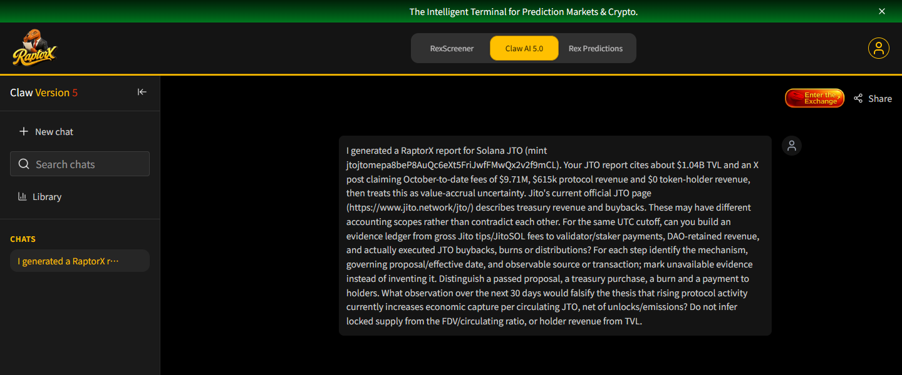

# JTO cash-flow scope and evidence

An AI-assisted RaptorX research entry recorded on 29 October 2026. The selected asset is Jito’s JTO on Solana, mint `jtojtomepa8beP8AuQc6eXt5FriJwfFMwQx2v2f9mCL`.

We generated JTO reports in RaptorX and entered the report-specific accounting question shown below in Claw AI 5.0. The questions test whether gross protocol activity, DAO treasury receipts, buybacks, burns and payments to token holders are being measured on the same accounting basis. They request observable records and a falsifiable 30-day test, with explicit treatment of missing evidence and changes in circulating supply.

The report’s quoted TVL, fees and revenue figures are premises to verify, not independently established findings of this entry. We do not conclude that a zero value in a data provider’s token-holder-revenue category proves that no treasury buyback occurred.

## Original site evidence

1. Report identity and native Solana mint.

2. The report context that motivated the accounting question.

3. The primary question in the logged-in Claw AI 5.0 conversation, still visible after refreshing it.

[Exact primary question](questions.md). These are native browser captures of the real website. The report and chat are separate parts of the interface. We did not obtain a verified cash-flow ledger and do not represent the question as answered conclusively.

## Reproduce the research

Sign in at [RaptorX](https://www.raptorx.trade/), select Solana in RexScreener, search JTO and verify the mint above, then generate its Full Report. Read the accounting context and enter the supplied question in Claw AI 5.0. Compare the figures’ scope and cutoff before drawing an inference about token-holder accrual.

The primary project source is [Jito’s JTO page](https://www.jito.network/jto/). Its discussion of treasury revenue and buybacks motivates a request for executed transactions and effective governance decisions; it is not itself proof of a specific distribution.

Prepared by an AI assistant for the account owner. No affiliation with Jito or RaptorX. No wallet funding, trade or subscription purchase was performed for this entry.

中文说明：材料包含官网真实生成的 JTO 报告及主要追问。重点是让模型提供可核查的资金流证据，并把统计口径、资料日期、治理提案与实际执行分开。尚未取得已验证的资金流答案，截图与问题本身是本次研究证据。
